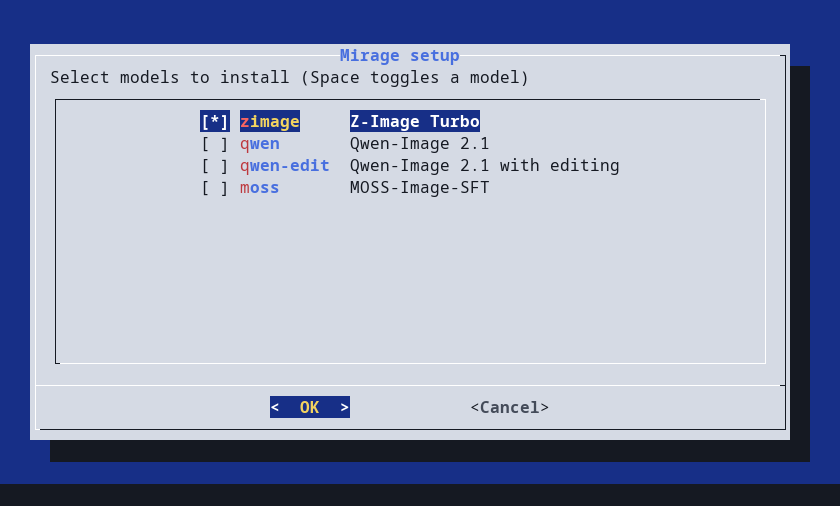
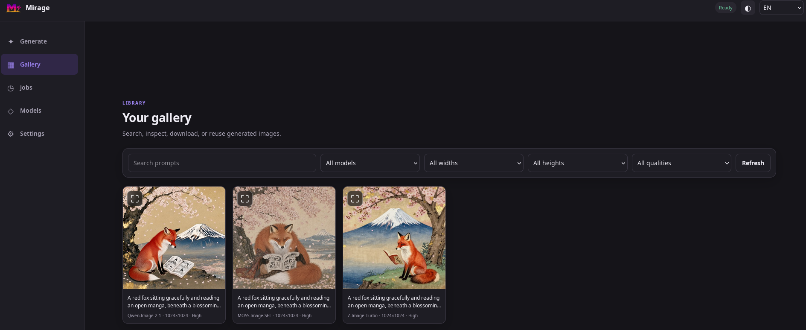

# Mirage


Mirage is a web interface for generating and editing images on your Linux machine. In your browser, write a prompt, track your jobs, and browse or download the results. Mirage runs [`stable-diffusion.cpp`](https://github.com/leejet/stable-diffusion.cpp) locally.

## 1. Install the web interface

You’ll need x86-64 Linux, Python 3.11+, and Podman or Docker with access to its API socket. Mirage automatically selects CUDA for an NVIDIA GPU with a configured NVIDIA Container Toolkit, or Vulkan for a GPU with a render device under `/dev/dri`. Allow at least 8 GB of free space for setup, plus 6.7 GB for the starter model, and an internet connection. CUDA builds require additional space for the CUDA toolchain.

The installer builds Mirage in containers and starts the web service. It uses the latest published release, the newest version-sorted Git tag if no release is published, or Git HEAD if there are no tags. Use `--backend cuda` or `--backend vulkan` to override automatic GPU detection; existing installations reuse their saved backend unless you override it. [NVIDIA setup](docs/OPERATIONS.md#nvidia-cuda-setup)

```sh
curl -fsSL https://raw.githubusercontent.com/dshein-alt/mirage/master/install.sh | sh
```

Run the same installation with Python’s standard library if you have no `curl`. [Python-only installer](docs/OPERATIONS.md#install-with-python)

If the installer finds a saved setup, choose whether to reuse it or start with defaults. Then choose **local** or **authenticated** access, a port, and the models to download. [Installer screens](docs/OPERATIONS.md#interactive-setup)



When the installer prints `Mirage is ready`, open the address it shows. The default is **[http://127.0.0.1:8765](http://127.0.0.1:8765)**. For authenticated access, sign in with your browser token.

Use `mirage stop` and `mirage start` from any directory. You can also run `~/.local/bin/mirage` by path. [Command-line usage](docs/OPERATIONS.md#use-the-command-line)

## 2. Add a model in the browser

If you skipped Z-Image Turbo in setup, open **Models**, find **Z-Image Turbo**, and click **Install**. Wait for the download job to finish in **Jobs**. You can return to **Models** later to add MOSS-Image-SFT or Qwen-Image 2.1.

## 3. Generate and find your first image

1. Open **Generate** and select **Z-Image Turbo**. Enter a prompt such as `A red fox reading under an oak tree`, choose a resolution and quality, then click **Queue generation**.
2. Follow progress in **Jobs**. You can close the browser tab while Mirage works.
3. Open **Gallery** to browse or search your finished images. Click an image’s prompt to open its details, then click **Download** to save the PNG. Mirage also stores PNGs and their metadata under `~/.local/share/mirage/data/outputs/` by default.



[Jobs screenshot and full-size generation examples](docs/EXAMPLES.md)

## Edit an existing image

Qwen-Image 2.1 editing needs more available GPU memory than text-to-image generation, even with Mirage’s automatic 4-bit attention cache. [Qwen editing and GPU memory](docs/OPERATIONS.md#qwen-editing-and-gpu-memory)

In **Models**, click **Install** on Qwen-Image 2.1. If Qwen is already installed without its editing component, click **Install with editing**. Once the model is ready, select **Qwen-Image 2.1** in **Generate**, add a file under **Reference images**, and describe the edit, such as `Change the car to dark green`. Click **Queue generation**.

## More help

- [Setup and maintenance](docs/OPERATIONS.md) covers CLI usage, LAN access, troubleshooting, updates, and backups.
- [Acceptance checklist](docs/ACCEPTANCE.md) covers automated tests and checks that require a GPU.

## License

Mirage and its pinned `stable-diffusion.cpp` dependency each use the MIT license. Model weights have separate licenses. [Mirage license](LICENSE) · [stable-diffusion.cpp license](https://github.com/leejet/stable-diffusion.cpp/blob/52491bd9f1fc15281791723bdff13baab7fd6819/LICENSE) · [Model registry](config/models.json)
