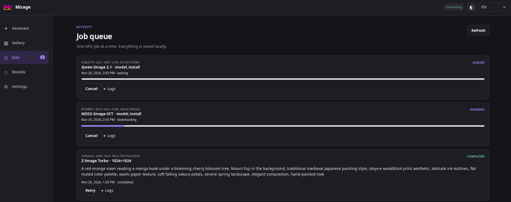

# Mirage generation examples

The **Jobs** page shows model downloads and image generation in the same queue. Open **Logs** on a job to see its output.

## Same prompt across three models

These text-to-image examples use Mirage’s **HD** resolution (1024×1024), **High** quality, the Euler sampler, and the Simple scheduler. The models use their own step counts, CFG scales, and seeds. Click an image to open the full-size PNG.

> A red fox sitting gracefully and reading an open manga, beneath a blossoming sakura tree, snow-capped Mount Fuji in the distance, classical Japanese medieval emakimono painting style, yamato-e aesthetic, mineral pigment colors, gold leaf accents, fine brushwork, parchment texture, drifting cherry blossom petals, tranquil atmosphere, horizontal composition

| Z-Image Turbo | MOSS-Image-SFT | Qwen-Image 2.1 |
| --- | --- | --- |
|  |  |  |
| 8 steps, CFG 1 · [Metadata](../assets/generated/20261126_z-image-turbo_hd_high-0001.json) | 50 steps, CFG 3 · [Metadata](../assets/generated/20261126_moss_hd_high-0001.json) | 40 steps, CFG 6 · [Metadata](../assets/generated/20261126_qwen-image-2.1_hd_high-0003.json) |
