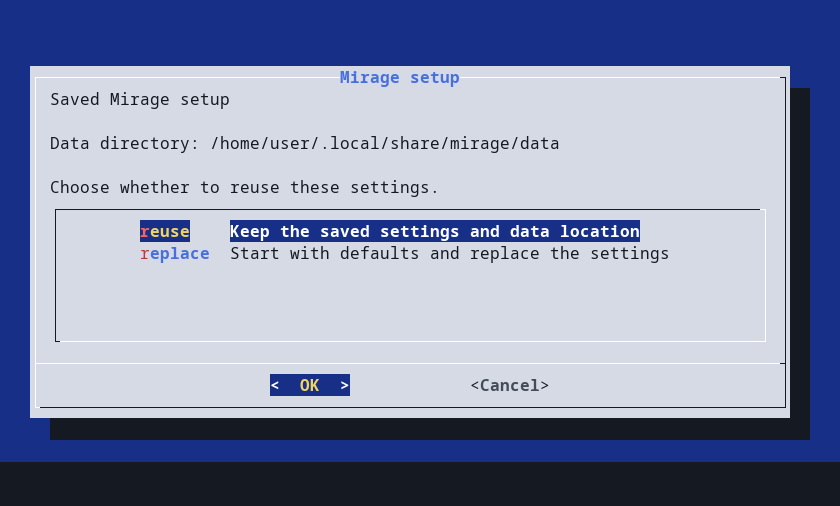
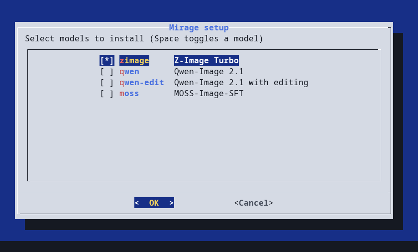

# Mirage setup and maintenance

The README walks through installing the web interface and creating your first image. [Quick start](../README.md#1-install-the-web-interface)

## Install with Python

This command uses Python’s standard library to fetch the installer. Mirage uses Docker or Podman to fetch the source and build the service.

```sh
python3 -c 'from urllib.request import urlopen; url = "https://raw.githubusercontent.com/dshein-alt/mirage/master/install.py"; exec(compile(urlopen(url, timeout=60).read(), url, "exec"))' \
  --standalone
```

To manage an existing installation with this command, add `update` or `remove --yes` before `--standalone`. You can also add the installer options below.

## Install with custom options

Pass options to the published shell installer after `sh -s --`. Run it with `--help` for all options.

```sh
curl -fsSL https://raw.githubusercontent.com/dshein-alt/mirage/master/install.sh | \
  sh -s -- --data-dir "$HOME/mirage-data" --port 9000 --runtime docker
```

| What Mirage stores | Default location | Override |
| --- | --- | --- |
| Installed source for standalone setups | `~/.local/share/mirage/sources/` | `XDG_DATA_HOME` |
| Models, images, settings, and database | `~/.local/share/mirage/data/` | `--data-dir` or `MIRAGE_DATA_DIR` |
| Installation record | `~/.local/state/mirage/installation.json` | `--state-file`, `MIRAGE_STATE_FILE`, or `XDG_STATE_HOME` |
| Command links | `~/.local/bin/mirage` and `~/bin/mirage` | `--prefix` adds a link in another directory |

The data directory follows `XDG_DATA_HOME` when no separate data directory is set. Model weights live in its `models/` subdirectory. To build from a development checkout, initialize its submodules and run `./install.sh` from the checkout. The installed data uses the same default location.

### GPU backend selection

The default `--backend auto` prefers CUDA when the NVIDIA driver exposes `/dev/nvidiactl` and at least one `/dev/nvidiaN` device. Otherwise, it selects Vulkan when a `/dev/dri/renderD*` device is available. Existing installations reuse the saved backend. Override either behavior with `--backend cuda`, `--backend vulkan`, or the `MIRAGE_BACKEND` environment variable.

CUDA and Vulkan use separate content-addressed runtime builds. The installer selects the matching `cuda-balanced` or `vulkan-balanced` model profile when creating a setup or switching backends, and verifies that the runtime container can see its devices before activation.

### NVIDIA CUDA setup

Install an NVIDIA driver and confirm that `nvidia-smi` works on the host. Install the [NVIDIA Container Toolkit](https://docs.nvidia.com/datacenter/cloud-native/container-toolkit/latest/install-guide.html); the host driver is not bundled into Mirage’s runtime image.

For Docker, configure and restart Docker according to the toolkit guide, normally with `sudo nvidia-ctk runtime configure --runtime=docker` followed by a Docker service restart. Mirage requests all NVIDIA GPUs through Docker’s device-request API.

For Podman, use Podman 5.4.2 or newer and the toolkit’s [CDI support](https://docs.nvidia.com/datacenter/cloud-native/container-toolkit/latest/cdi-support.html). `nvidia-ctk cdi list` must report `nvidia.com/gpu=all`; recent toolkit versions generate this specification automatically. Mirage requests that CDI device for CUDA jobs and runtime verification.

Then install or switch an existing setup explicitly:

```sh
./install.sh --backend cuda
./install.sh update --backend cuda --non-interactive --skip-models
```

The CUDA build targets NVIDIA compute capabilities 61, 70, 75, 80, 86, 89, 90, 100, and 120. NVIDIA hardware inference is not covered by the automated non-GPU test suite; run the [acceptance checks](ACCEPTANCE.md) on the target host.

### Interactive setup

When Mirage finds a saved setup, choose **reuse** to keep its settings and data location or **replace** to start with defaults. If the data location changes, old models, images, and job history stay at their previous location. Explicit options still apply. Use `--non-interactive --replace-settings` to replace the saved setup without prompts.



The installer then prompts for access mode, port, and the models to install. It uses `dialog` or `whiptail` when available and plain terminal prompts otherwise. New setups default to local access, port `8765`, and Z-Image Turbo.



### Unattended setup and local model files

Pass a model ID or a comma-separated list. `all` includes Qwen’s editing component. With the published shell installer, add the options after `sh -s --`. In the Python command, add them after `--standalone`. The following examples use a development checkout.

```sh
./install.sh --non-interactive --models zimage
./install.sh --non-interactive --models moss,qwen-edit
./install.sh --non-interactive --skip-models
```

If you already have the model files, pass their parent directory to `--import-models`. Inside it, use the filenames and relative paths from the model registry. For example, the Z-Image Turbo files go under `zimage/`. The installer checks file sizes and imports the files from disk. Container setup may still need internet access. [Model registry](../config/models.json)

```sh
./install.sh --non-interactive --models zimage --import-models /path/to/models
mirage models verify zimage
```

If a download is interrupted, run the same `mirage models install` command again to resume. Set `HF_TOKEN` before installation or service startup if Hugging Face requires a token for the files you need.

### Qwen editing and GPU memory

Select **Install with editing** in the browser, `--models qwen-edit` in the standalone installer, or `mirage models install qwen --with-editing` from the command line to install the vision projector. When a Qwen-Image 2.1 job includes reference images, Mirage selects 4-bit (`q4_1`) storage for the text and reference attention cache. Quantizing the cache can change the output slightly. Text-to-image jobs use sd.cpp’s default cache precision.

Editing needs more available GPU memory than text-to-image generation. A GPU with **8 GB of VRAM** can run out of memory for the attention cache, especially at HD and above. When the cache cannot fit, sd.cpp can continue with slower, uncached sampling. Available memory and usage depend on the backend, resolution, reference images, and other GPU workloads. If editing slows down or affects desktop responsiveness, try the `sd` resolution preset (512×512).

### Use a different release source

The standalone installer prefers the latest published Mirage release on GitHub. If the release endpoint reports no release, it checks the repository’s tags in descending version order. It uses the repository’s default branch at Git HEAD when there are no tags. You can override the release metadata URL and the Git repository. A release response must include a `tag_name` field.

```sh
curl -fsSL https://raw.githubusercontent.com/dshein-alt/mirage/master/install.sh | \
  sh -s -- --release-api "$release_api" --repository "$release_repository"
```

## Use the command line

The installer prints the command links it created. Use `mirage --help` to see service, image, and maintenance commands. If your shell cannot find `mirage`, add one of the printed directories to `PATH` or run a printed link by its full path. Browser and terminal submissions use the same queue.

```sh
mirage models install qwen --with-editing --wait
mirage generate --wait -m zimage -p 'A red fox reading under an oak tree'
mirage jobs list
mirage gallery list --search fox
```

Use `mirage start` and `mirage stop` to control the web service, or `mirage logs` to follow its logs.

## Manage jobs and settings

| Task | Command |
| --- | --- |
| Follow a job | `mirage jobs wait JOB_ID` |
| Inspect a job’s logs | `mirage jobs logs JOB_ID` |
| Cancel or retry | `mirage jobs cancel JOB_ID` or `mirage jobs retry JOB_ID` |
| Export an image | `mirage gallery export IMAGE_ID ./exported.png` |
| Check installed models | `mirage models list` |

Get job and image IDs from `mirage jobs list` and `mirage gallery list`. After a service restart, a job that was running is marked `interrupted`. Retrying creates a new job and output filename.

The resolution presets are `sd` (512×512), `hd` (1024×1024, the default), and `fhd` (1920×1080). Change model-specific quality settings in **Settings** or edit `data/config/generation-presets.json` and run `mirage config validate` followed by `mirage config reload`. Jobs already in the queue keep the settings they were submitted with.

## Allow access from another device

In the default `local` mode, Mirage listens on `127.0.0.1` and gives local users administrator access without a sign-in. For access from other devices, use `authenticated` mode on a trusted LAN or behind an authenticated HTTPS reverse proxy. The service can control containers through the engine socket. Keep it off the public internet.

Choose **authenticated** in the setup prompts to enter both tokens without echo. For unattended setup, set both tokens before running the installer. For a new installation, omit `update`.

```sh
export MIRAGE_API_TOKEN="$(python3 -c 'import secrets; print(secrets.token_urlsafe(32))')"
export MIRAGE_BROWSER_TOKEN="$(python3 -c 'import secrets; print(secrets.token_urlsafe(32))')"
curl -fsSL https://raw.githubusercontent.com/dshein-alt/mirage/master/install.sh | \
  sh -s -- update --mode authenticated --non-interactive --skip-models
```

Open the Mirage server’s LAN address and port, or the proxy’s HTTPS URL, and sign in with one of the tokens.

- `MIRAGE_API_TOKEN` grants administrator access in the browser and authenticates CLI and API requests. API clients send it in the `Authorization: Bearer` header.
- `MIRAGE_BROWSER_TOKEN` allows browser users to generate images, manage jobs, use the gallery, and install models. Administrative settings and runtime controls require the administrator token.

Save the tokens securely. They must differ and each must contain 16–64 ASCII letters, digits, underscores, or hyphens. Export the API token for CLI requests and both tokens before recreating the service. To rotate tokens, export the new values and rerun the installer update. To change the port, pass `--port` to the installer.

For Compose, set `MIRAGE_APP_IMAGE` to the built application image ID or unique tag, `MIRAGE_HOST_DATA_DIR` to the absolute data path, `CONTAINER_SOCKET` to the engine socket, and `MIRAGE_CONTAINER_ENGINE` to the engine name. The authenticated file also requires both tokens. Set `MIRAGE_PORT` to override `8765`. [Local Compose](../compose.yaml) · [Authenticated Compose](../compose.authenticated.yaml)

## Troubleshoot

| If you see this | What to check |
| --- | --- |
| The browser cannot connect | Use the port printed by the installer. Run `mirage start` and check `mirage logs`. |
| The installer cannot find the engine socket | For rootless Podman with systemd, run `systemctl --user enable --now podman.socket`. For Docker, check that the daemon is running and your user can access its socket. |
| A model is missing from your installation | Check **Models** or run `mirage models list`. Install the model and wait for the download job to finish before submitting a prompt. For Qwen editing, include its optional component. |
| Mirage cannot use the GPU | For Vulkan, check access to a render device under `/dev/dri`. For CUDA, check `nvidia-smi`, NVIDIA Container Toolkit configuration, and Podman CDI devices where applicable. With Mirage running, use `mirage runtime verify --devices` to check device visibility in the runtime. |
| The runtime image is missing | Run `mirage runtime repair` to recreate it from a verified runtime release when available. |

Use `mirage runtime status` to see the active release. When no generation jobs are active, `mirage runtime rollback` can restore a previous release on the same GPU backend. Use the installer to switch GPU backends.

## Update or remove Mirage

Wait for queued and running jobs to finish. For a standalone installation, use the installer to fetch the current release or Git revision.

```sh
curl -fsSL https://raw.githubusercontent.com/dshein-alt/mirage/master/install.sh | sh -s -- update
```

For a development checkout, switch to the version you want and run `git submodule update --init --recursive`. Then run the installer from that checkout.

```sh
./install.sh update --non-interactive --skip-models
```

The update verifies the new build, backs up the database and configuration, and keeps the models, images, and other user data. If an update is interrupted, rerun the installer so it can recover before starting another operation.

To uninstall a standalone installation, run the shell installer with `sh -s -- remove`. From a checkout, run `./install.sh remove`. After you confirm the application uninstall, Mirage asks separately whether to permanently delete each group from the data directory it shows.

- **Downloaded models** includes model weights and partial downloads.
- **User data** includes the database, job history and logs, reference images, generated images, thumbnails, and backups stored by Mirage.

Press Enter at either data prompt to keep that group. For an unattended uninstall, pass `--yes --non-interactive`. Add `--purge-models` or `--purge-data` to delete the corresponding group. Settings and cached runtimes stay in the data directory for reinstalling.

## Back up and restore data

The data directory contains the SQLite database, settings, reference images, generated PNGs and metadata, model files, and compiled runtimes. Use the path printed by the installer. It defaults to `~/.local/share/mirage/data`.

While Mirage is running, use `mirage backup` to copy the database, settings, and images into the data directory’s `backups/` folder. For a full copy that includes model weights and compiled runtimes, use the following steps.

Wait for active jobs to finish, then stop Mirage and copy the full directory. Allow enough free space for the models and runtimes as well as the images.

```sh
data_dir="${XDG_DATA_HOME:-$HOME/.local/share}/mirage/data"
mirage stop && cp -a "$data_dir" "$HOME/mirage-backup-$(date +%Y%m%d-%H%M%S)"
mirage start
```

To restore, stop Mirage if it is running and copy the backup to a new data directory. Point the installation at that directory so the launcher remembers it.

```sh
curl -fsSL https://raw.githubusercontent.com/dshein-alt/mirage/master/install.sh | \
  sh -s -- update --data-dir "$HOME/mirage-restored"
```

On a fresh machine, omit `update` and use the same data directory option. To rebuild the gallery index from existing PNGs and JSON metadata, run `mirage gallery reindex`.

## API and development

Mirage’s JSON API is under `/api/v1`. Fetch `/openapi.json` on your Mirage server for the API schema. The server-sent event stream is at `/api/v1/events`.

Run `uv run --locked --dev pytest -q` on the host or `./scripts/test.sh` with a container engine. The automated suite uses fixtures and runs without a GPU. [Acceptance checklist](ACCEPTANCE.md)

Run `./scripts/package.sh` to create a source archive in `dist/` with the local submodule tree included.
